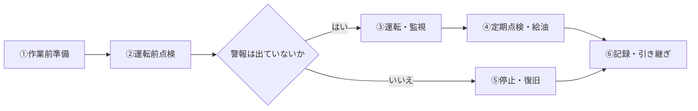

# マニュアルmd構成ルール

再現性のあるマニュアルは、次の **3要素 = 3ファイル(=3タブ)** で構成します。

| 順 | ファイル名 | 要素 | 書く内容 |
|---|---|---|---|
| 1 | `1_マインドセット.md` | マインドセット | 姿勢・考え方、本質、目的、ゴールイメージ、目安 |
| 2 | `2_ワークフロー.md` | ワークフロー | スタンダードな流れ(フローチャート・所要時間)、関係者 |
| 3 | `3_オペレーション.md` | オペレーション | ルール、手順、方法、例(用語集・参照資料) |

タブ名はファイル名(拡張子なし)になります。

## 各ファイルの見出しルール

`# タイトル` は1ファイルに1つ。以下の `##` 見出しは固定し、順番も変えません。

### 1_マインドセット.md
- `## 姿勢・考え方`
- `## 本質`
- `## 目的`
- `## ゴールイメージ`
- `## 目安`

### 2_ワークフロー.md
- `## スタンダードな流れ`
- `## 関係者`

### 3_オペレーション.md
- `## ルール`
- `## 手順`
- `## 方法`
- `## 例`

必要な場合のみ、末尾に `## 用語集・参照資料` を追加できます(下記「用語集・参照資料」参照)。

## 各ファイルに書く内容(サンプルの構成に準拠)

### 1_マインドセット.md
- `## 目的`:設備・業務が何のためにあるか、止まるとどうなるかを書く。
- `## ゴールイメージ`:「〜な状態」の形で箇条書きにする(例:汚泥が滞留せず、一定のペースで引き抜き口へ集まっている状態)。
- `## 姿勢・考え方`:太字の短い主張+理由の形で書く(例:**「動いている=正常」ではありません。** 〜)。安全は作業品質の一部、迷ったら止めて相談する、など判断の軸を書く。
- `## 目安`:全体の所要時間などを単位つきで書く。

### 2_ワークフロー.md
- `## スタンダードな流れ` は次の2つをセットで書く。
  1. Mermaidのフローチャート(後述)
  2. ステップ表(`ステップ | 内容 | 所要時間の目安`)
- ステップ名は丸数字で番号を付ける(① 作業前準備 → ② 運転前点検 → …)。
- 全体の所要時間の目安(定期点検など追加が発生する日の加算も含む)を太字で1行添える。
- `## 関係者` は表で書き、オペレーションで使う「誰が」と同じ名称にする。

### 3_オペレーション.md
- ステップごとに `###` 見出しを立て、ワークフローのステップ名と所要時間を合わせる(例:`### ② 運転前点検(10〜15分)`)。
- 周期・基準がある項目は表(`項目 | 内容 | 目安周期`)で書く。
- 通常時と異常時は小見出し(太字)で分ける(例:**通常停止** / **異常発生時**)。
- 異常発生時は「安全に停止 → 状況を記録 → 連絡 → 原因確認 → 試運転で復旧確認」の順で書く。
- 最後のステップは記録・引き継ぎとし、日報に書く項目を箇条書きにする。

## 書き方のルール

1. **手順は番号付きリスト(`1.` `2.` ...)で書く。** 1項目=1動作。HTML化すると各項目に画像を差し込める。
2. 数値・基準は「目安」として単位つきで書く。
3. 判断が必要な箇所は「〜の場合は〜する」と条件を明記する。
4. 安全上の注意は引用(`> ⚠️ ...`)で書く。種類は次の3つに分け、太字の見出しを付ける。
   - `> ⚠️ **重要ポイント:〜**` :確認漏れが重大なトラブルにつながること
   - `> ⚠️ **ミスが起きやすいポイント**` :箇条書きでよくあるミスを挙げる(重大事故につながるものは太字)
   - `> ⚠️ **俗人化しやすいポイント:〜**` :人によって判断が分かれること。記録(写真・動画・日報)で基準をそろえる方法を書く
5. 「誰が」はワークフローの関係者名に合わせて統一する。
6. 「関係者」「ルール」「目安」は表で書くと見やすい。
7. **現場や機種によって変わる箇所・確認が取れていない箇所には `【要確認】` を付ける。** 例:定格値、正常範囲、点検周期、社内規程。確定したら外す。
8. 重要な語句・数値・禁止事項は `**太字**` で強調する。
9. **フローチャートはMermaid記法で書き、コードをコピーできる形にする。**
   - `2_ワークフロー.md` の `## スタンダードな流れ` に ` ```mermaid ` のコードブロックで書く。
   - 向きは `flowchart LR`(横)か `flowchart TD`(縦)を使う。
   - ノード名はステップ表・関係者の名称と一致させる。
   - 判断が必要な箇所は菱形 `{ }` で書き、分岐ラベル(`|はい|` `|いいえ|`)に条件を明記する。
   - コードブロックをそのままコピーして Mermaid Live Editor などに貼れば図になる状態にする。
   - 図が表示されない環境のため、同じ内容をステップ表でも書く。

### フローチャートの記述例

````markdown

````

## 用語集・参照資料

専門用語や社内用語が出てくるマニュアルでは、`3_オペレーション.md` の末尾に `## 用語集・参照資料` を置く。

- `### 用語集`:`用語 | 意味` の表で書く。
- `### 参照資料`:メーカー取扱説明書、社内規程、過去の記録、緊急連絡網などを箇条書きにする。未確認のものは `【要確認】` を付ける。

## 変換

```
python convert.py "samples/sludge-collector/1_マインドセット.md" "samples/sludge-collector/2_ワークフロー.md" "samples/sludge-collector/3_オペレーション.md" -o sludge.html -t "汚泥掻き寄せ機"
```
