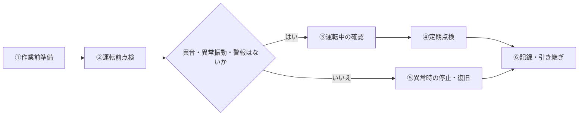

# 反応槽 水中撹拌機 点検手順書:ワークフロー

## スタンダードな流れ

| ステップ | 内容 | 所要時間の目安 |
|---|---|---|
| ① 作業前準備 | 保護具・工具・点検表の準備、作業者と連絡先の確認 | 5〜10分 |
| ② 運転前点検 | 外観、吊り上げチェーン・ガイドレール、ケーブル、制御盤の確認 | 10〜15分 |
| ③ 運転中の確認 | 異音・振動・電流値・撹拌状況の確認 | 10〜15分 |
| ④ 定期点検 | 絶縁抵抗測定、羽根の摩耗確認、シール・オイルの確認 | 30〜60分【要確認】 |
| ⑤ 異常時の停止・復旧 | 安全に停止し、記録・連絡・原因確認・試運転で復旧を確認 | 状況による |
| ⑥ 記録・引き継ぎ | 日報記入、次の担当者への申し送り | 5〜10分 |

**全体の所要時間の目安:通常日 約30〜45分/定期点検の日は +30〜60分【要確認】**

## 関係者

| 関係者 | 役割 |
|---|---|
| 点検担当者 | 点検の実施と記録 |
| 補助者 | 安全監視、点検の補助(2人作業の相方) |
| 責任者 | 異常時の判断、復旧の可否判断 |
| 電気担当者 | 制御盤・電源・絶縁測定などの電気作業【要確認】 |
| メーカー・保守業者 | 分解整備や部品交換【要確認】 |
